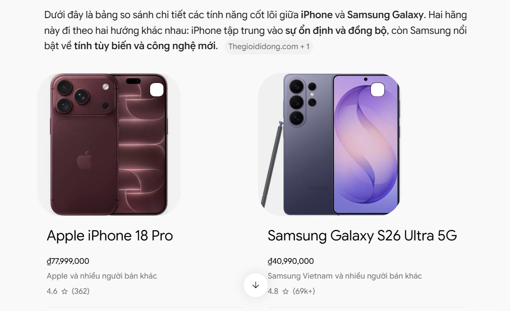
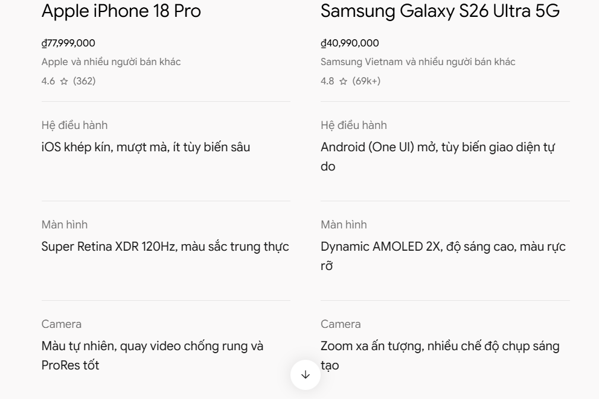
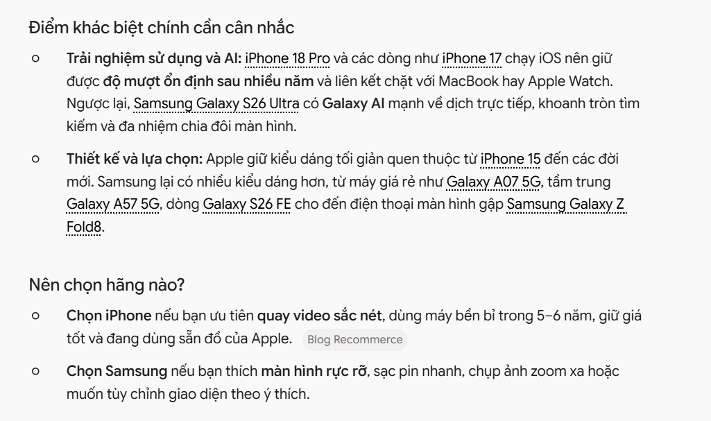

# Thiết kế prompt so sánh tính năng iPhone và Samsung

## ***Bước 1: Phân tích Input và Output***
***1. Dữ liệu đầu vào (Input)***

Đối tượng so sánh chính xác: Phiên bản cao cấp nhất của mỗi dòng gồm iPhone 16 Pro Max và Samsung Galaxy S24 Ultra (loại trừ hoàn toàn bản thường, bản Plus hoặc bản Pro nhỏ).

Nhóm thông số cần trích xuất:

Pin & Sạc: Dung lượng pin (mAh - lưu ý Apple không công bố chính thức mAh trên trang chủ), thời lượng phát video tối đa (giờ), công suất sạc có dây/không dây.

Camera: Độ phân giải các ống kính sau, khả năng zoom quang học, độ phân giải camera trước, chuẩn quay video tối đa.

Nguồn dữ liệu bắt buộc: Chỉ lấy từ trang chủ chính thức của Apple (apple.com) và Samsung (samsung.com).

***2. Cấu trúc đầu ra mong muốn (Output)***

Phần 1 - Bảng so sánh ngang: Gồm 3 cột (Tiêu chí thông số | iPhone 16 Pro Max | Samsung Galaxy S24 Ultra) và các hàng tương ứng với từng hạng mục về Pin và Camera.
# CONTEXT (Ngữ cảnh)
Bạn là một chuyên gia phân tích thông số kỹ thuật thiết bị di động. Tôi đang cần viết một bài tư vấn khách hàng so sánh ngắn gọn, chính xác 100% giữa hai dòng điện thoại flagship: iPhone 16 Pro Max và Samsung Galaxy S24 Ultra.

# REQUEST (Nhiệm vụ)
Hãy trích xuất thông số kỹ thuật về Pin và Camera của hai mẫu máy trên, trình bày dưới dạng bảng so sánh ngang và tổng hợp 2 điểm mạnh lớn nhất của từng dòng máy.

# EXPLANATION (Giải thích)
Bài viết dùng để gửi trực tiếp cho khách hàng đang phân vân chọn mua máy nên yêu cầu độ chuẩn xác tuyệt đối về mặt số liệu, tránh gây hiểu lầm hoặc sai lệch thông tin kỹ thuật giữa các phiên bản.

# ACTION (Hành động)
Thực hiện tuần tự theo 3 bước sau:
1. Chỉ tra cứu và trích xuất dữ liệu từ trang thông số chính thức của Apple (apple.com) cho iPhone 16 Pro Max và trang chính thức của Samsung (samsung.com) cho Galaxy S24 Ultra.
2. Lập một bảng so sánh ngang gồm 3 cột: Tiêu chí | iPhone 16 Pro Max | Samsung Galaxy S24 Ultra. Các hàng bắt buộc gồm: Dung lượng pin (mAh), Thời lượng xem video tối đa, Công nghệ sạc, Hệ thống Camera sau, Khả năng Zoom quang học, Camera trước, Chuẩn quay video tối đa.
3. Ngay bên dưới bảng, liệt kê ngắn gọn 2 điểm mạnh lớn nhất (tập trung vào pin và camera) cho mỗi dòng máy.

# TONE (Giọng điệu)
Khách quan, chuyên nghiệp, súc tích và rõ ràng.

# EXTRAS (Ràng buộc & Khóa an toàn)
- Nghiêm cấm tự suy đoán, ước lượng hoặc lấy số liệu từ các trang tin rò rỉ/bên thứ ba không chính thống.
- Nếu hãng sản xuất không công bố thông số đó trên trang chủ (ví dụ: Apple không công bố dung lượng pin theo đơn vị mAh), bắt buộc phải ghi rõ cụm từ: "Chưa xác thực (Hãng không công bố)".
- Tuyệt đối không nhầm lẫn thông số sang bản iPhone 16 Pro, iPhone 16 thường hoặc Galaxy S24/S24+.

